# Hardcore Mario Bros (Aug 24, 2024)
A remake of the first level of Super Mario Bros., reimagined with a much higher difficulty.

---

## The Mechanics
This game reuses the core mechanics of the original Super Mario Bros.

| **Jump** | **Hit Block** | **Kill Goomba** |
| :---: | :---: | :---: |
| 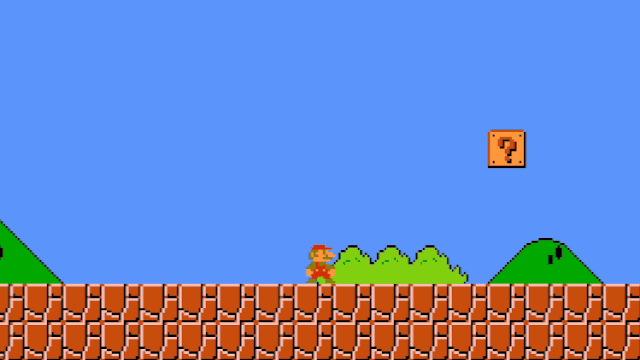 | 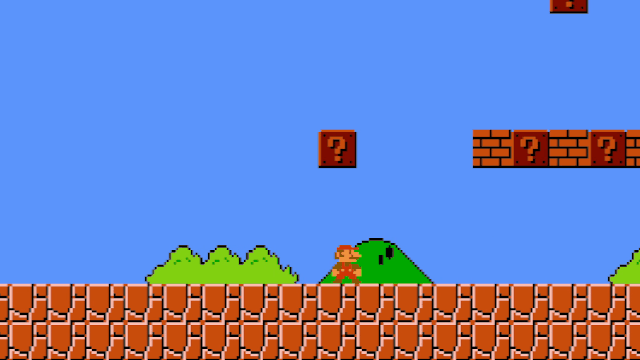 | 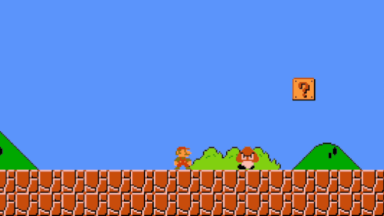 |

| **Take Power-up** | **Collect Coins** | **Enter Pipe** |
| :---: | :---: | :---: |
| 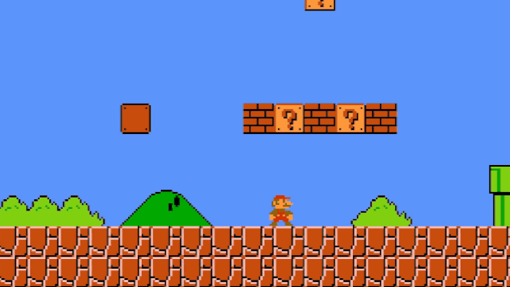 | 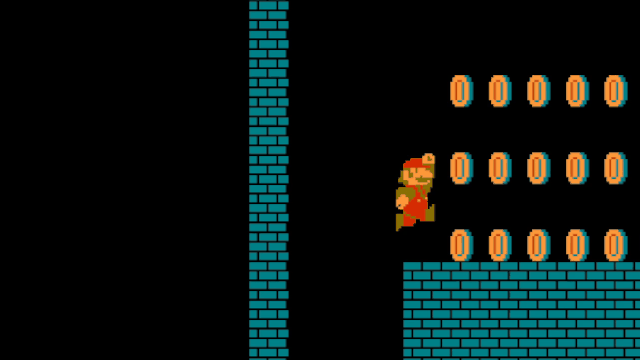 | 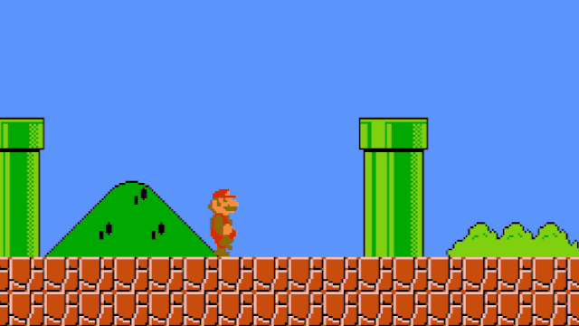 |

---

## New Levels
In addition to a tougher version of World 1-1, I designed four brand-new, deliberately difficult (and somewhat unfair!) levels designed to test players' patience. I also custom-redesigned the textures to give the game a darker, more menacing atmosphere.

| **1. Raining Level** | **2. Sky Level** |
| :---: | :---: |
| 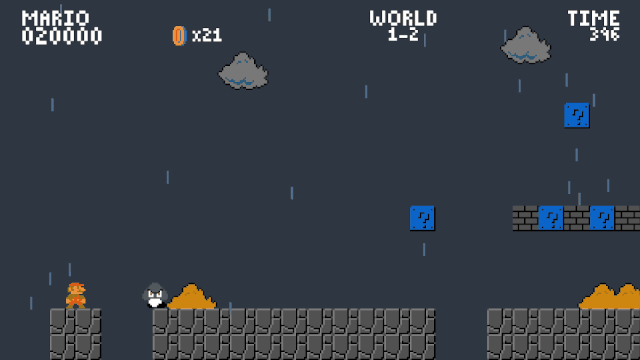 | 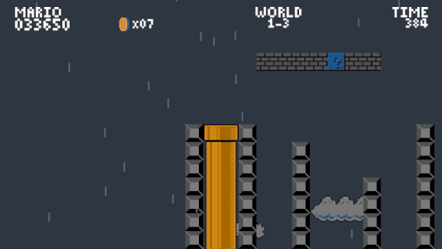 |

| **3. Cave Level** | **4. Castle Level** |
| :---: | :---: |
| 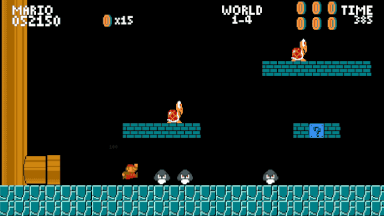 | 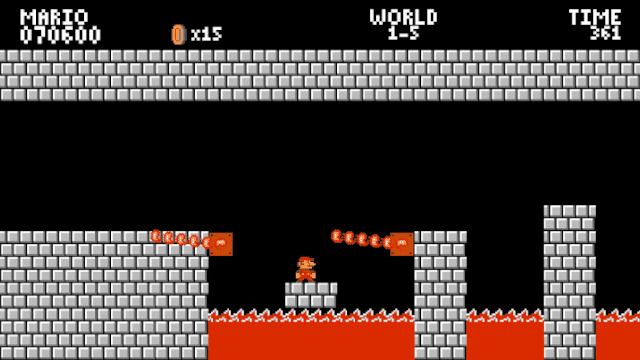 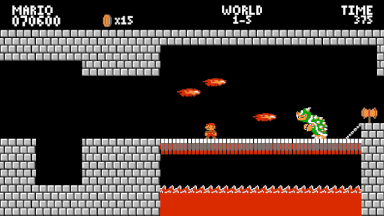 |

---

## Watch the Video
You can watch a devlog/video I made about it (in French):
[Watch on YouTube](https://youtu.be/jfwfdiMI0x0?si=C0vmMd9m9qwuveVF)

---

## Play
You can play the game directly on [`itch.io`](https://remaf300.itch.io/hardcoremariobros) (play at your own risk!).

## Credits
This game was made following this tutorial [`video`](https://www.youtube.com/watch?v=GCkq6XqyJZg).